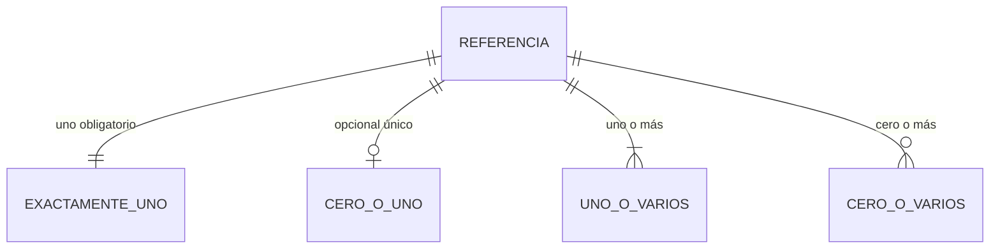
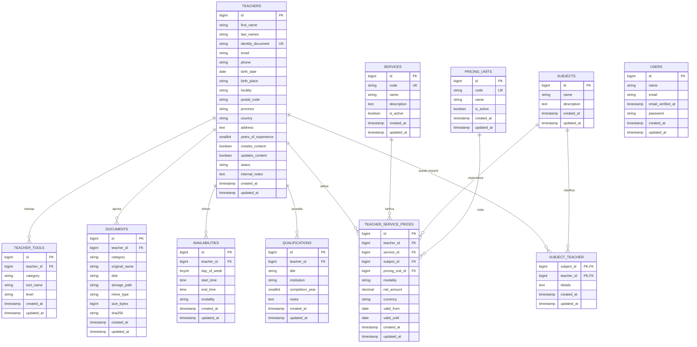

# Diagrama entidad-relación

Última revisión: 2026-09-29

Este documento representa tanto el modelo implementado como su evolución prevista. El estado técnico y el diseño funcional se indican por separado: una tabla puede estar implementada y conservar decisiones provisionales. Las entidades únicamente provisionales no equivalen a migraciones aprobadas ni ejecutadas.

## Estado

| Entidad | Estado | Observación |
|---|---|---|
| `users` | Implementada | Personal autorizado; independiente de los profesores |
| `teachers` | Implementada | Datos personales, contacto, experiencia, estado y observaciones internas |
| `subjects` | Implementada | Vocabulario abierto y reutilizable de materias |
| `subject_teacher` | Implementada | Relación muchos-a-muchos con detalle opcional |
| `qualifications` | Implementada | Titulación, institución, año de finalización y notas |
| `availabilities` | Implementada | Franjas semanales por profesor y modalidad |
| `documents` | Implementada | Metadatos de archivos privados validados y almacenados fuera de `public/` |
| `teacher_tools` | Implementada | Programas e IA mediante categoría, herramienta y nivel |
| `services` | Implementada | Catálogo administrable y desactivable de servicios |
| `pricing_units` | Implementada | Unidades ampliables; inicialmente hora, curso y jornada |
| `teacher_service_prices` | Implementada | Importe neto en EUR con ámbito e histórico de vigencia |

## Leyenda de cardinalidades

Los símbolos se leen desde cada extremo de la relación:

- `||`: exactamente uno; la relación es obligatoria.
- `o|`: cero o uno; la relación es opcional y única.
- `|{`: uno o varios; debe existir al menos uno.
- `o{`: cero, uno o varios; la relación puede no existir.

### Memoria visual



### Cómo leer una relación

```text
TEACHERS ||--o{ DOCUMENTS
```

Se lee en ambos sentidos:

- Un profesor puede aportar cero o muchos documentos.
- Cada documento pertenece exactamente a un profesor.

La tabla intermedia convierte dos relaciones uno-a-muchos en una relación muchos-a-muchos:

```text
TEACHERS ||--o{ SUBJECT_TEACHER }o--|| SUBJECTS
```

Por tanto, un profesor puede impartir varias materias y una materia puede ser impartida por varios profesores.

## DER actual



## Relación entre profesores y materias

La relación muchos-a-muchos permite compartir una materia entre varios profesores:

- `subjects.id` es una clave primaria `BIGINT UNSIGNED` autoincremental.
- `subjects.name` es `VARCHAR(150) NOT NULL` y admite entradas de texto libre dentro de un vocabulario abierto y reutilizable; no representa un catálogo cerrado.
- `subjects.description` es `TEXT NULL`.
- `subject_teacher` usa `subject_id` y `teacher_id` como clave primaria compuesta.
- Ambas columnas son claves foráneas `BIGINT UNSIGNED` con `ON DELETE CASCADE`.
- La pivot conserva `details TEXT NULL`, `created_at` y `updated_at`; `details` describe el contenido específico que puede impartir ese profesor.
- `Teacher::subjects()` y `Subject::teachers()` usan `belongsToMany`, `withPivot('details')` y `withTimestamps()`.

## Disponibilidad

La relación uno-a-muchos representa franjas semanales del profesor:

- `availabilities.id` es una clave primaria `BIGINT UNSIGNED` autoincremental.
- `teacher_id` es una clave foránea `BIGINT UNSIGNED NOT NULL` hacia `teachers.id` con `ON DELETE CASCADE`.
- `day_of_week` es `TINYINT UNSIGNED NOT NULL`; usa la convención ISO `1 = lunes` y `7 = domingo`.
- `start_time` y `end_time` son `TIME NOT NULL`.
- `modality` es `VARCHAR(20) NOT NULL` y cada fila representa una única modalidad.
- La tabla conserva `created_at` y `updated_at`.
- `Teacher::availabilities()` usa una relación `HasMany` y `Availability::teacher()` una relación `BelongsTo`.
- Las modalidades admitidas por la aplicación son presencial y en línea.

## Lugar de nacimiento implementado

- La migración reversible `2026_09_22_000000_add_birth_place_to_teachers_table.php` se aplicó correctamente.
- `teachers.birth_place` es `VARCHAR(150) NULL` y se sitúa después de `birth_date`.
- `Teacher::$fillable` y `TeacherFactory` incluyen `birth_place`.

## Herramientas de software e IA implementadas

- `teacher_tools.teacher_id` referencia `teachers.id` con `ON DELETE CASCADE`.
- Cada fila conserva `category`, `tool_name` y `level`.
- Las categorías son `software` y `ai`; los niveles admitidos son básico, intermedio y avanzado.
- `Teacher::teacherTools()` usa una relación `HasMany` y `TeacherTool::teacher()` una relación `BelongsTo`.
- La relación está cubierta por una prueba con datos ficticios.

## Documentos privados

La tabla `documents` contiene metadatos; los archivos son privados y permanecen fuera de MariaDB:

- `teacher_id` referencia `teachers.id` con `ON DELETE CASCADE`.
- Se almacenan `category`, `original_name`, `disk`, `storage_path`, `mime_type`, `size_bytes` y `sha256`.
- Currículum: PDF o DOCX.
- Fotografía: JPG, JPEG, PNG o WEBP.
- Titulación: PDF, JPG, JPEG o PNG.
- Otros: PDF, DOCX, JPG, JPEG o PNG.
- Cada envío contendrá un único archivo y el límite máximo será de 10 MB.
- El nombre físico será opaco; incluir nombre y apellidos en el nombre original será una recomendación visible, no una validación obligatoria.
- La aplicación valida conjuntamente categoría, extensión, tipo MIME real y límite de 10 MB.
- La relación Eloquent es `Teacher::documents()` como `HasMany` y `Document::teacher()` como `BelongsTo`.

## Servicios y PVP implementados

- `services` mantiene un catálogo reutilizable y desactivable de servicios.
- `pricing_units` permite añadir unidades sin cambiar el esquema. Las unidades iniciales son hora, curso y jornada.
- `teacher_service_prices` pertenece obligatoriamente a un profesor, un servicio y una unidad. La materia es opcional.
- `subject_id = NULL` representa cualquier materia; `modality = all` representa presencial y en línea.
- `net_amount` usa `DECIMAL(10,2)`, admite cero y siempre representa un importe sin IVA.
- `currency` queda restringida a `EUR`.
- `valid_from` y `valid_until` son fechas inclusivas; `valid_until = NULL` representa una vigencia abierta.
- Las claves foráneas restringen el borrado para conservar el histórico.
- Un servicio transaccional bloquea el profesor y rechaza vigencias solapadas en el mismo ámbito exacto. No modifica automáticamente periodos existentes.
- Cuando coinciden ámbitos generales y específicos, la selección prioriza: materia y modalidad exactas; materia exacta y cualquier modalidad; cualquier materia y modalidad exacta; ámbito totalmente general.

## Decisiones funcionales vigentes

### Confirmado

- El PVP se expresa por servicio y puede variar; no se modelará como un precio fijo único e inmutable.
- Los programas y herramientas de IA se registran mediante filas independientes con categoría, nombre y nivel.
- `creates_content` y `updates_content` representan indicadores independientes; ambos ya existen técnicamente en `teachers`.
- Las materias se introducen como texto libre. La tabla `subjects` implementada debe permitir entradas abiertas y no actuar como catálogo cerrado.
- Los lugares concretos de trabajo permanecen en el currículum; no se exige por ahora una colección estructurada de empleos.

### Trabajo futuro no bloqueante

- Valorar catálogos adicionales para herramientas y materias si una futura evolución los necesita.
- Decidir cómo conservar un resumen de experiencia estructurado y buscable sin convertir los lugares de trabajo del CV en una colección de empleos. Se mantiene como criterio técnico mínimo salvo rechazo expreso del cliente.

## Relaciones futuras

- No existe por ahora una relación entre `users` y `teachers`.
- El posible acceso futuro de los profesores requerirá una decisión funcional específica.
- No existe auditoría funcional de operaciones; se definirá únicamente si surge el requisito.
